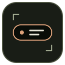
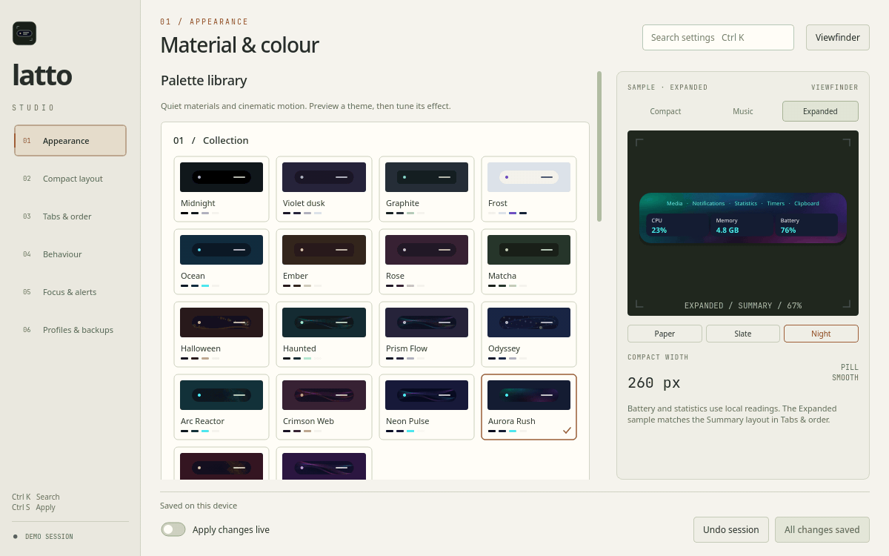
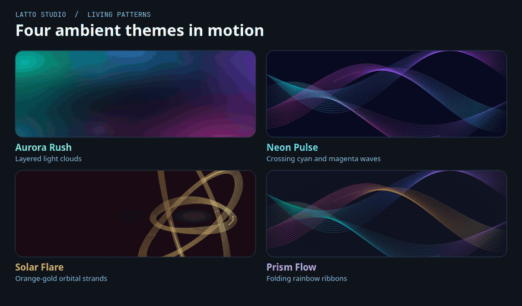
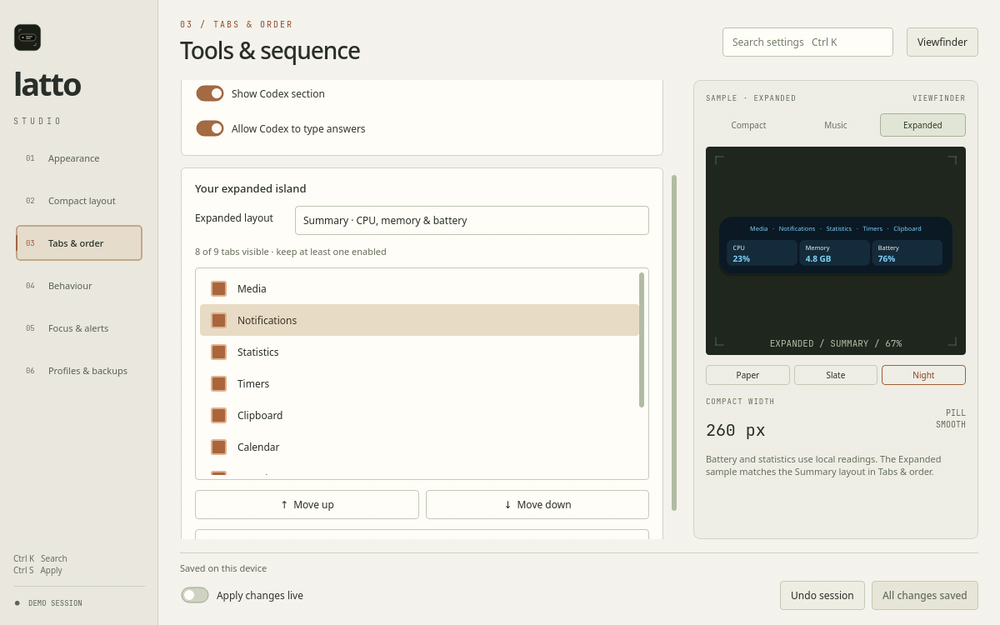

<p align="center"></p>
<h1 align="center">Latto Studio</h1>
<p align="center"><strong>A native editor for the Latto dynamic island on Linux.</strong><br>
Preview a new look, tune how the island moves, and put your everyday tools within reach.</p>

<p align="center">
  <a href="#try-studio">Try Studio</a> ·
  <a href="#living-patterns">See the animations</a> ·
  <a href="#from-draft-to-desktop">See the workflow</a>
</p>



## Try Studio

The demo runs on Linux with Python 3.10+ and PySide6. It starts with Aurora Rush and keeps its settings in a temporary directory. Quickshell is optional for the demo.

```sh
git clone https://github.com/ScaraMouche-Wanderer/latto-studio.git
cd latto-studio
python3 -m venv .venv
. .venv/bin/activate
python -m pip install -r requirements.txt
python studio/demo.py
```

Try a palette, switch the viewfinder between **Compact**, **Music**, and **Expanded**, or open **Tabs & order** to change the tab sequence.

## Living patterns

Choose from **10 animated themes** and **8 quiet palettes**. Ambient effects sit behind the controls. Change the motif, strength, and speed independently. Reduced motion freezes the motif, and hiding the preview pauses its animation.



The gallery uses the same vector renderer as the Studio preview. The recordings use sample media and system readings.

## From draft to desktop

Turn off **Apply changes live** to stage edits in the viewfinder. Use **Apply changes** to save, and **Undo session** to restore the settings you started with. Import and export portable JSON profiles or recover from a local configuration backup.



| In Studio | What you can configure |
| --- | --- |
| Appearance | Palettes, animated motifs, custom colors, borders, and reduced motion |
| Compact layout | Width, position, clock format, battery, CPU, memory, and activity indicators |
| Tabs & order | Visible tabs and their order, plus an expanded summary layout |
| Behaviour | Hover timing, island presence, typography, and statistics refresh |
| Focus & alerts | Pomodoro timing, Do Not Disturb behavior, privacy indicators, and alert timing |
| Profiles & backups | Draft imports, profile export, configuration backups, and session undo |

## The island in everyday use

The companion shell brings media controls, notifications, clipboard history, system statistics, quick toggles, timers, and a calendar into one expandable island. Some modules depend on the shell version, compositor, and installed integrations. Studio and the isolated demo are included here. The Quickshell island and bar live in Fadilix’s upstream project. [Upstream Latto](https://github.com/Fadilix/latto)

For live configuration, CLI theme controls, and verification commands, see the [Studio guide](docs/studio-guide.md).

If you want to follow the project, star the repo. If you try the demo, screenshots and reproducible feedback are welcome in [GitHub Issues](https://github.com/ScaraMouche-Wanderer/latto-studio/issues).
